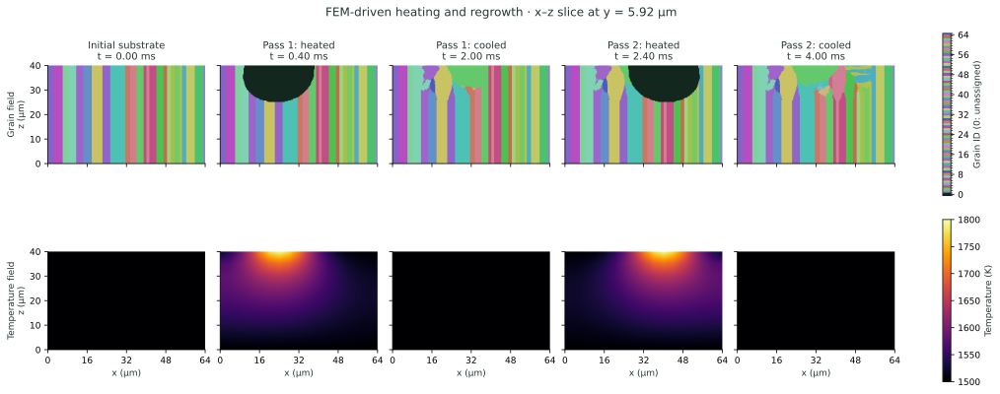

# AMMicrostructure

**Three-dimensional cellular automaton modelling of grain growth in laser powder bed fusion of metals (PBF-LB/M).**

Developed by Ferdinand O. Schnell for his 2024 bachelor’s thesis at the Technical University of Munich, this Julia implementation follows nucleation, melting, remelting and competitive grain growth from finite element temperature histories. Decentered octahedra represent orientation-dependent growth, while grain postprocessing extracts size, aspect ratio and orientation for a microstructure-dependent fracture model.

[Read the thesis](docs/assets/publications/FSchnell_BAThesis_AMMicrostructure.pdf) · [Research and results](docs/research.md) · [Documentation](docs/index.md)



*Grain structure and temperature through two heating and cooling cycles. The second pass remelts part of the structure formed during the first. Colours identify individual grains.*

## The model

- Temperature transfer from the FEM mesh to a Cartesian cellular-automaton grid.
- Undercooling-dependent nucleation and crystallographic growth orientations.
- Decentered-octahedron capture, with grain identity and orientation inherited by captured cells.
- Persistent grain structure through successive melting and solidification cycles.
- Grain-size, morphology and orientation analysis for fracture modelling.

The thesis examines single-track solidification, mesh refinement and multilayer grain evolution. Its implementation supports both coupled execution with CalculiX and standalone calculations using stored temperature histories.

## Run a simulation

With [Julia 1.10 or newer](https://julialang.org/downloads/) installed, run from the repository root:

```sh
julia --project=. --threads=8,0 examples/fem_replay/run.jl
```

The two-pass example contains 6.64 million cells and starts from 64 substrate grains. Thermal inputs are included, so it runs without a CalculiX installation. Open `output/fem_replay/preview.svg` to view the grain structure, or inspect the VTK fields in a scientific viewer. Use `--resolution fine` or `--resolution quick` for a smaller grid.

See the [quickstart](docs/quickstart.md) for execution and outputs, and [FEM integration](docs/fem-integration.md) to supply temperatures from a thermal solver.

## Explore the work

| Topic | Guide |
| --- | --- |
| Thesis contribution and results | [Research](docs/research.md) |
| Cell states, nucleation and grain capture | [Cellular automaton model](docs/model-scope.md) |
| Temperature fields and the state API | [Simulation API](docs/architecture.md) |
| Coupled and standalone calculations | [FEM integration](docs/fem-integration.md) |
| Grain sections and thermal histories | [Simulation figures](docs/figures.md) |

## Publication

This work contributed to Panzer et al., *Experimentally informed physics-based multi-scale simulation for microstructure tailoring and cracking behavior modification in Inconel 718 during PBF-LB/M*, **Materials & Design 269** (2026), 116714. Ferdinand Schnell is credited with **Software** and **Investigation**. [Read the publication](https://doi.org/10.1016/j.matdes.2026.116714).

The growth algorithm follows [Gandin and Rappaz (1997)](https://doi.org/10.1016/S1359-6454(96)00303-5). Bibliographic information is available in [CITATION.cff](CITATION.cff).

Thesis and figures © 2024 Ferdinand O. Schnell. Reproduced publication figures retain their source attribution and CC BY 4.0 license.

[Development and demo notes](demo/notes.md)
