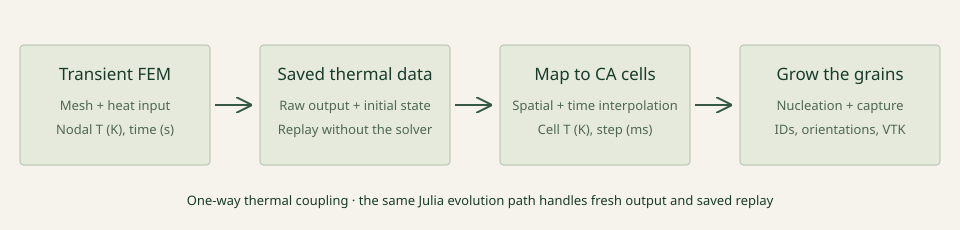

# FEM thermal handoff

The FEM calculation supplies a temperature history; the cellular automaton maps it to CA cells and evolves nucleation, grain growth, melting and regrowth. This one-way thermal coupling connects the process calculation to the microstructure model.



## Replay a saved thermal history

```sh
julia --project=. --threads=8,0 examples/fem_replay/run.jl --resolution quick
```

The bundled [`two_pass_heating_demo` dataset](../data/two_pass_heating_demo/README.md) contains a nodal temperature history and structured mesh. Replay writes a visual preview, VTK snapshots, and histories under `output/fem_replay/`. The [quickstart](quickstart.md) also shows a prescribed directional-solidification example.

## Input and units

The structured mesh provides increasing x, y, and z coordinate axes in metres and a node-ID grid. The thermal series provides explicit node IDs, increasing times in seconds, and one temperature value per node and time in kelvin. The adapter maps each CA cell centre by trilinear interpolation and interpolates linearly between adjacent saved times. It rejects missing nodes, cells outside the mesh, and requests outside the saved time range.

At the interface, metres are converted to millimetres and seconds to milliseconds. CA temperatures remain in kelvin. The CA grid dimensions and cell spacing are specified separately from the FEM mesh. The supported adapter assumes a structured rectangular mesh; other element geometries require an element-location and shape-function mapping suited to that mesh.

## Generate a new thermal history

With Julia and a working CalculiX CrunchiX executable available, run:

```sh
julia --project=. --threads=8,0 integrations/calculix/run.jl --ccx /path/to/ccx
```

The resulting temperature history and grain fields are written under `output/calculix/`. Solver installation notes are in [`demo/notes.md`](../demo/notes.md).
