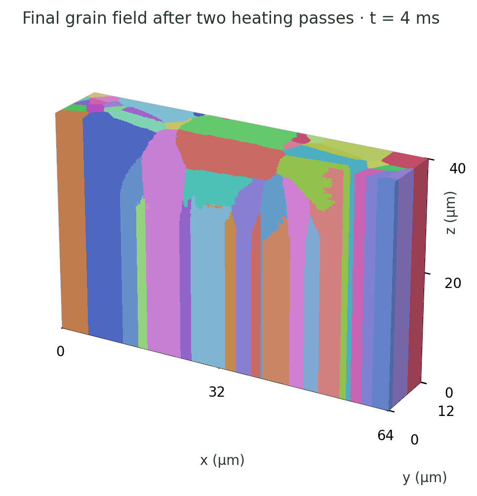
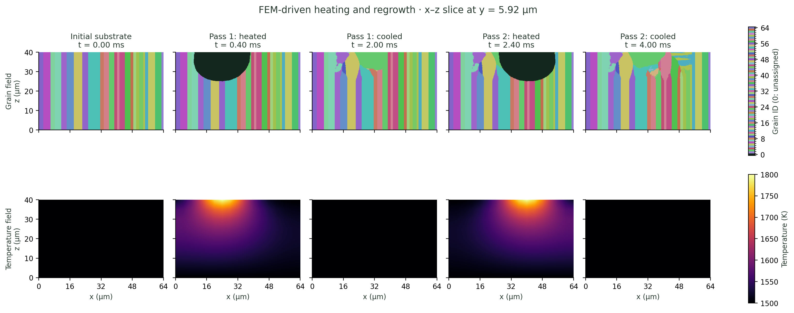
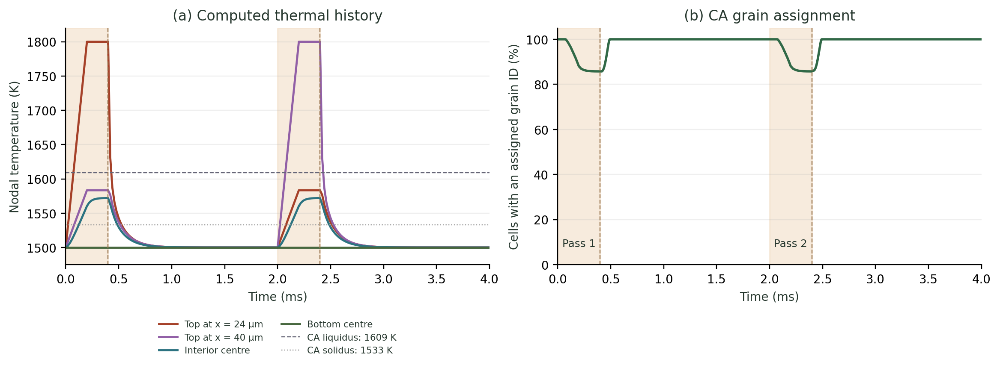

# Figures

These figures show grain structure through two successive heating and cooling cycles. Colours identify individual grains; dark regions have no assigned grain.

## Grain structure

The final grain field occupies a 64 × 12 × 40 µm volume. Competitive growth reshapes the substrate grains within the two overlapping melt pools.

The x–z sections show the initial substrate and the heated and cooled states of each pass. Cell spacing is 0.167 µm; the section lies at y ≈ 5.92 µm.

## Thermal history

The plot pairs the temperature history with the fraction of cells carrying a grain identity. Heating removes grain assignments in the melted region; cooling restores them through regrowth.

## Time-resolved microstructure

*Initial substrate, t = 0 ms.*

*After the first heating and cooling cycle, t = 2 ms.*

*After the second cycle, t = 4 ms.*

The second cycle acts on the structure left by the first. The fixed section shows how surviving grains advance into the remelted region and meet along new boundaries.
