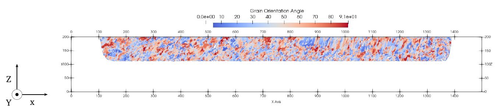
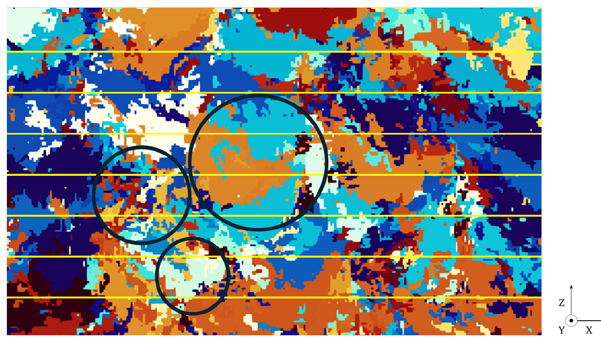
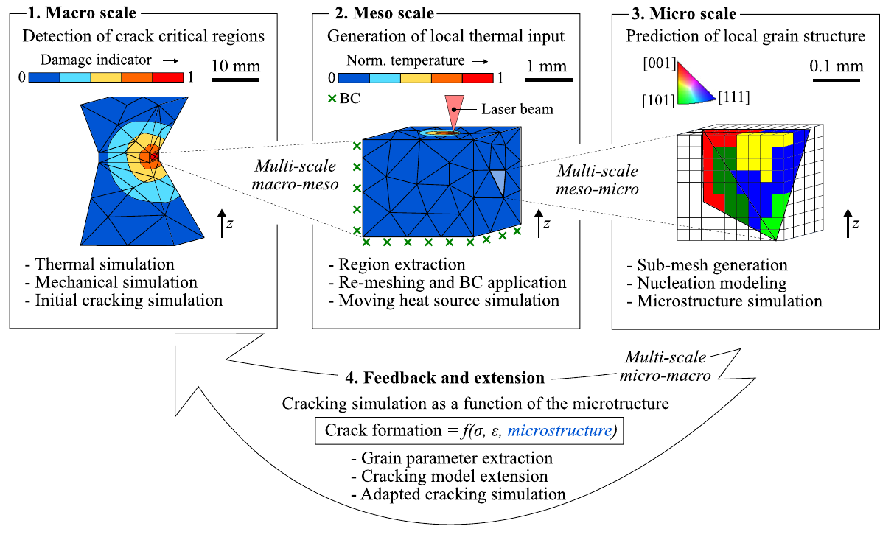

# Grain growth in PBF-LB/M

Ferdinand O. Schnell’s bachelor’s thesis develops a three-dimensional cellular automaton for grain evolution during laser powder bed fusion of metals. The Julia model connects finite element temperature histories with local grain structure and extracts microstructural descriptors for fracture modelling. The work was completed at the Technical University of Munich in 2024, supervised by Hannes Panzer. [1, §§3.1–3.3]

> “Methods to extract the relevant microstructural parameters were developed, and a fracture model incorporating this information devised.”
>
> — Schnell, thesis abstract [1]

## Software contribution

The implementation combines temperature transfer, nucleation, anisotropic grain growth and microstructure analysis:

- **FEM coupling.** Interpolation connects nodal temperatures on the finite element mesh to cell centres on a regular Cartesian grid. Coupled and standalone execution use the same grain-growth model.
- **Cell-state evolution.** Temperature histories determine melting and solidification. Persistent grain identities allow existing grains to grow into remelted regions.
- **Nucleation and capture.** A Gaussian undercooling distribution controls nucleation. Decentered octahedra advance according to crystallographic orientation and capture neighbouring cells.
- **Parallel updates.** A select–test–resolve–update procedure organises candidate selection, transition evaluation and state changes. An active region follows the current build height.
- **Grain postprocessing.** Size, aspect ratio and orientation descriptors connect the labelled grain volume to a proposed microstructure-dependent Johnson–Cook fracture model.

These components are described in Chapter 3 of the thesis, printed pp. 25–40. [1]

## Grain-growth method

The model uses the decentered-octahedron algorithm of Gandin and Rappaz [3]. Each cell belongs to a grain with a specified orientation. An octahedral envelope represents its dendritic growth directions. As undercooling drives the envelope outward, neighbouring cell centres enter the envelope and inherit the grain identity and orientation. Repositioning the captured cell’s octahedron carries the growth front through the lattice.

The FEM temperature interval is subdivided into CA steps. Each step updates cell states, evaluates nucleation, advances growth envelopes and resolves capture. Melting clears grain assignments in the heated region; subsequent cooling allows surviving grains to grow into it. [1, §§3.1.1–3.1.3, printed pp. 26–31]

## Single-track solidification

*Schnell [1], Fig. 4.1, printed p. 42 / PDF p. 58. Bulk nucleation is disabled (`N0 = 0`), exposing growth from the existing melt-pool boundary. Cropped from the thesis; © 2024 Ferdinand O. Schnell.*

The single-track study follows solidification from pre-existing grains at the melt-pool boundary. With bulk nucleation disabled, changes in grain structure arise through capture by the surrounding grains. The accompanying mesh study examines the effect of cell spacing and supports a 2 µm spacing for the investigated case. [1, Figs. 4.1–4.3, printed pp. 42–43]

## Multilayer grain evolution

*Schnell [1], Fig. 4.7, printed p. 46 / PDF p. 62. X–Z section for Scenario 2 at 285 W. Yellow lines mark successive powder-bed heights; circles identify local structures discussed in the thesis. Cropped; © 2024 Ferdinand O. Schnell.*

Successive layers subject the existing grain structure to further heating, remelting and solidification. Grains grow across layer boundaries as new material solidifies against the preceding structure. The thesis examines local grain evolution and the effects of process conditions and nucleation parameters on the resulting grain distribution. [1, §4.2, printed pp. 44–47]

## Microstructure and fracture modelling

The grain volume supplies descriptors for a proposed extension of the Johnson–Cook fracture model. Grain size and the loading direction relative to elongated grains enter the formulation, connecting the microstructure calculation to the assessment of fracture criticality. The thesis derives the model and examines the grain-size dependence using existing data. [1, §§3.3 and 4.3, printed pp. 37–40 and 48–49]

## Research application

The work contributed to the multi-scale Inconel 718 study published by Panzer et al. in *Materials & Design* [2]. The publication connects thermal simulation, microstructure and cracking behaviour. Its CRediT statement lists Ferdinand Schnell’s contributions as **Software** and **Investigation**.

*Panzer et al. [2], Fig. 2, p. 4. Cropped; © 2026 the authors, [CC BY 4.0](https://creativecommons.org/licenses/by/4.0/).*

## References

**[1] Ferdinand O. Schnell (2024).** *Simulating Grain Growth in PBF-LB/M with a Cellular Automaton Model to Determine Fracture Criticality.* Bachelor’s thesis, TUM School of Engineering and Design, Technical University of Munich. Submitted 31 May 2024. [Complete thesis (PDF)](assets/publications/Ferdinand_O_Schnell_BA.pdf).

**[2] Hannes Panzer, Saeed Maleksaeedi, Hamidreza Aghajani, Mohsen K. Keshavarz, Fangzhou Li, Ferdinand Schnell, Kai-Uwe Beuerlein, Felix Riegger, and Michael F. Zaeh (2026).** *Experimentally informed physics-based multi-scale simulation for microstructure tailoring and cracking behavior modification in Inconel 718 during PBF-LB/M.* **Materials & Design 269**, 116714. [doi:10.1016/j.matdes.2026.116714](https://doi.org/10.1016/j.matdes.2026.116714).

**[3] Ch.-A. Gandin and M. Rappaz (1997).** *A 3D Cellular Automaton algorithm for the prediction of dendritic grain growth.* **Acta Materialia 45**(5), 2187–2195. [doi:10.1016/S1359-6454(96)00303-5](https://doi.org/10.1016/S1359-6454(96)00303-5).

Thesis and thesis figures © 2024 Ferdinand O. Schnell. The reproduced publication figure is licensed under CC BY 4.0, with attribution in its caption.
